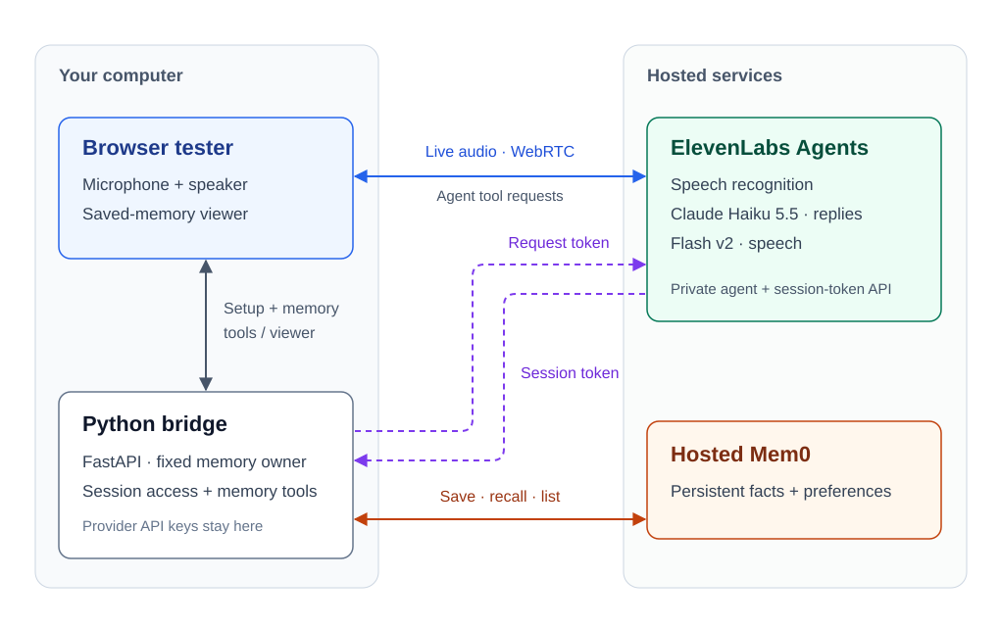

# Whisper Stack

**A personal voice assistant that remembers between conversations.**

Whisper Stack combines ElevenLabs Agents, Claude Haiku 5.5, and hosted Mem0 for
spoken conversations with persistent memory. You can ask a question, interrupt
an answer, and recall saved preferences in a new session.

**Browser backend complete · Physical-device integration next**

The working prototype runs in a browser. The goal is a USB-powered desk device
with its own microphone, speaker, display, and controls, connected over Wi-Fi
and able to work with the development computer switched off.

[How it works](#how-it-works) · [Run locally](#run-locally) ·
[Verification](#verification) · [Next milestones](#next-milestones)

> [!WARNING]
> **Historical Implementation and Security Notice**: Code in `server/`, `firmware/`, and `tools/` represents an unsupported May 2026 prototype with known limitations: authentication is disabled by default when `API_KEY` is empty, unencrypted HTTP carries plaintext audio and keys, enterprise Wi-Fi skips server CA certificate validation, raw request bodies are buffered in memory, exceptions may be exposed in error responses, and the legacy web client uses unsafe `innerHTML` rendering. Root dependency manifests (`requirements.txt`) and historical scripts belong solely to that earlier prototype. The recommended and maintained setup is the local, single-owner browser backend in `experiments/agents-mem0/`, which is intended for private local use and is not ready for public hosting, tunnels, or multi-tenant deployment.

## What works

- **Voice conversation:** speech recognition, spoken replies, natural
  interruptions, and follow-up questions through the official WebRTC client.
- **Quiet waiting:** after answering, the assistant waits for you to speak again.
- **Memory across sessions:** save facts and preferences, then recall them in a
  later conversation. Normal recall excludes superseded facts.
- **Memory viewer:** load saved memories on demand, refresh, and browse pages.
  The viewer includes history and does not start a voice session.

The implementation lives in [experiments/agents-mem0/](experiments/agents-mem0/README.md).
Despite the directory name, this is the selected main backend.

## How it works



1. **Connect:** the browser asks the local bridge for a session token, then
   connects to the private ElevenLabs agent. Provider API keys stay server-side.
2. **Talk:** ElevenLabs handles speech recognition, Haiku 5.5 generates replies,
   and Flash v2 turns them into speech. Live audio travels directly between the
   browser and ElevenLabs over WebRTC.
3. **Remember:** when the agent requests a memory tool, the browser forwards it
   to the bridge. The bridge saves or retrieves facts in Mem0 for the configured
   owner and returns the result. The memory viewer uses that same bridge.

The local bridge must stay running. Device transport and remote hosting are
still to be built; browser WebRTC does not establish an ESP32 audio connection.

## Run locally

You need the Python and Node dependencies, ElevenLabs and Mem0 credentials, and
access to the configured private agent. Follow the
[setup guide](experiments/agents-mem0/README.md#reproduce-and-verify) first;
cloning the repository does not provision cloud resources.

From the repository root, with setup complete:

```sh
# Check local settings and browser assets without contacting providers.
experiments/agents-mem0/.venv/bin/python experiments/agents-mem0/web_server.py --check

# Start the local tester.
experiments/agents-mem0/.venv/bin/python experiments/agents-mem0/web_server.py
```

Open **http://127.0.0.1:8766**, choose **Start conversation**, and allow microphone
access. **End conversation** closes the session. Opening the page leaves the
microphone off; starting a conversation uses provider credits.

If a tester is already running, reuse the address in the
[current handoff](docs/STATUS.md). Chrome and Edge have worked in user testing;
see [troubleshooting](experiments/agents-mem0/README.md#startup-diagnostics)
for microphone, connection, and privacy-extension issues.

This is a local, single-owner prototype. Keys belong in ignored `.env` files;
conversation recordings and memories are stored by the providers according to
their settings. See [privacy, saved-data controls, and usage](experiments/agents-mem0/README.md#personal-prototype-essentials).

## Verification

The browser-backend milestone is complete for personal use. Checks last passed
on October 28, 2026; voice and hosted-answer results below are prior live evidence.

| Check | Evidence |
| --- | --- |
| Voice, interruptions, quiet waiting, and recall across sessions | Accepted in user testing |
| Local service and evaluation-runner checks | 49 Python checks passed with mocked providers |
| Browser behavior and SDK loading | 10 browser checks passed with mocked providers |
| Corrected facts and unknown-answer handling | [8 of 8 hosted text-answer cases passed scoped review](experiments/agents-mem0/evaluation/answers-2026-10-27.md) |
| Conversation context without Mem0 | [3 opening details recalled after 20 intervening exchanges](experiments/agents-mem0/evaluation/context-2026-10-27.md) |

These are bounded checks. They do not establish hardware behavior, large-store
reliability, or multi-hour context handling. Reasoning and reply-length rough
edges are recorded in [the detailed results and handoff](docs/STATUS.md).

## Next milestones

| Milestone | Status |
| --- | --- |
| Browser voice, memory, and personal-prototype essentials | Complete |
| One spoken question and answer on the physical device | Next: connection method and hardware verification |
| Device controls, display, and recovery behavior | Planned |
| Operation with the development computer switched off | Planned: hosting and authenticated access |
| Enclosed USB-powered desk prototype | Planned |

The next increment connects the existing backend to the device. Further backend
changes should support that exchange. See [project decisions and scope](docs/PROJECT.md).

## Repository guide

| Location | Purpose |
| --- | --- |
| [experiments/agents-mem0/](experiments/agents-mem0/README.md) | Selected backend, browser tester, memory bridge, and evaluations |
| [docs/PROJECT.md](docs/PROJECT.md) | Goal, decisions, and remaining milestones |
| [docs/STATUS.md](docs/STATUS.md) | Current state, verification, and session handoff |
| [backend/](backend/README.md) | Earlier independent October voice pipeline |
| [server/](server/), [firmware/](firmware/), [tests/](tests/), [tools/](tools/) | Preserved May prototype |
| [notes/archive/](notes/archive/) | Historical setup and technical context |

<details>
<summary>Earlier implementations</summary>

The May 2026 prototype used **Whisper → Gemini 2.5 Flash → Kokoro**, with a
workstation handling conversation and Markdown files storing history. It
included ESP32 firmware, wake-word detection, displays, and browser/terminal
clients. Its [original README](notes/archive/README-before-overview-2026-10-26.md)
and [technical notes](notes/archive/claude-context-2026-05.md) remain as reference.

The earlier October rebuild in `backend/` uses separate speech-to-text, Haiku,
and text-to-speech calls. It includes push-to-talk, overlapping streamed
playback, bounded web search, and token/cost diagnostics. It runs independently;
those features and its Flash v2.5 setting are not inherited by the selected
Agents path, which uses Flash v2.

</details>

Coding agents should start with [AGENTS.md](AGENTS.md).

## License

GPL-3.0-or-later. See [LICENSE](LICENSE). The historical firmware includes a port
of [FluxGarage RoboEyes](https://github.com/FluxGarage/RoboEyes) by Dennis Hoelscher.
